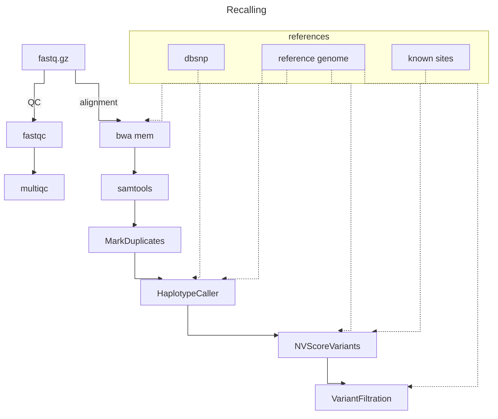
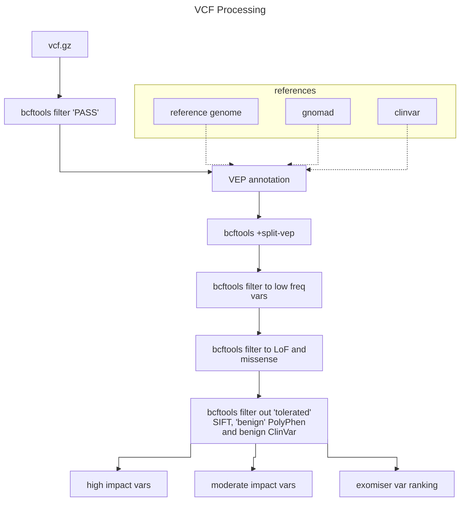

# Rare Disease, Real Kid — MVA Hackathon 2026

Submission window:
24 Aug 2026 – 24 Oct 2026.

This repository provides a Nextflow pipeline for analysis of the Rare Disease, Real Kid Hackathon dataset.

It is a two-step pipeline: first (optional) step is recalling from fastq files and outputs a vcf file.



Second step is performed on a vcf file, either the output of the first step or the challenge's provided pre-processed vcf file, and does annotation, filtering and ranking based on phenotypes.



## Setup

### 1. Clone the repo

Clone the repo and move into its directory

```bash
git clone git@github.com:JReneWong/Xocolatl_MX.git
cd Xocolatl_MX
```

### (Optional) Setup VM

We use a Nextflow pipeline to run analysis on the provided dataset.

The pipeline can either use Apptainer or micromamba/conda to handle environments.

If using Apptainer, consider it only runs on Linux. If you're using MacOS you can follow the next steps to setup a Linux VM.

<details>
<summary>Create a Linux VM with MacOS</summary>

We recommend using Lima to create the VM.

```bash
# Install Lima (VM manager) via Homebrew
brew install lima
```

The VM config is defined under `lima/hackathon-vm.yaml`. You can edit it to setup specific resources for the VM. If you're using an external drive, edit the config yaml file to set the mount point for the VM.

Start the VM

```bash
limactl start --name=hackathon lima/hackathon-vm.yaml
limactl shell hackathon
```

You should now be inside an Ubuntu VM, perform the rest of the steps within the VM. If you configured an external drive it will be mounted at the path you defined in the yaml file.

If you need to resize the VM you can do so by editting the VM
e.g.
```bash
limactl edit hackathon --cpus 4
```

</details>

### 2. Install Nextflow

Follow [seqera's docs on installing Nextflow](https://docs.seqera.io/nextflow/install). 

### 3. Environment setup

Use either Apptainer or micromamba/conda

<details>
<summary>Aptainer</summary>

Install apptainer

```bash
sudo apt update
sudo apt install -y software-properties-common
sudo add-apt-repository -y ppa:apptainer/ppa
sudo apt update
sudo apt install -y apptainer
apptainer --version
```

Run the command from the directory you want the image to be created at

```shell
apptainer build container/env.sif container/env.def
apptainer build container/vep.sif container/vep.def
apptainer build container/exomiser.sif container/exomiser.def
```

This builds two `.sif` images. Building can take a while and use a fair bit of RAM/CPU.

Environment dependencies are defined in the yaml files under `container/`.

- **`env.sif`** (`/opt/env`, from `env.yaml`) — Python 3.11 environment, alignment, variant calling, QC, pipeline
- **`vep.sif`** (`/opt/vep-env`, from `vep-env.yaml`) - Ensembl VEP

After building, capture the version manifest:

```bash
bash scripts/record_versions.sh
```
</details>

<details>
<summary>Conda/Micromamba</summary>

Follow either [micromamba](https://mamba.readthedocs.io/en/latest/installation/micromamba-installation.html)'s (recommended) or [conda](https://docs.conda.io/projects/conda/en/latest/user-guide/install/index.html)'s docs on installation.

You do not have to create the environments as Nextflow will handle them as needed. You could however create them and then configure Nextflow to use existing environments, refer to their documentation for more information.

Environment dependencies are defined in the yaml files under `container/`.

- **`env`** — Python 3.11 environment, alignment, variant calling, QC, pipeline.
- **`vep-env`** - Ensembl VEP.

</details>

### 4. Download the challenge data (~85GB)

```bash
bash scripts/download_data.sh
```

### 4b. Download reference data (genome, dbSNP, ClinVar, VEP cache, exomiser cli and data)

Run the script to download references to `data/references`

```bash
bash scripts/download_references.sh
```

This includes:
- Genome + BWA index from **Broad Institute's public GATK resource bundle** (~3.2GB + 6.4GB)
- dbSNP from **Broad Institute's public GATK resource bundle** (~1.6GB)
- ClinVar from **NCBI** (184MB)
- VEP cache from **ENSEMBL** (~26GB)
- Known sites resources from **Broad Institute's public GATK resource bundle** (~63MB + ~22MB + ~62MB)
- Exomiser CLI + data from **Exomiser GitHub** (~30GB)

### 4c. Reference gnomAD

We use a concatenated gnomAD v3.1.2 genomes vcf file (from the vcf files available at https://gnomad.broadinstitute.org/downloads#v3) that we store at `data/references/gnomad`.

Given the size of the vcf files, we recommend concatenating or filtering by mounting a Google Cloud Storage Bucket with GCSFuse.

If you use a different gnomAD vcf, make sure to update the path in the `nextflow.config` file and potentially update the `lowfreqvar` process in the pipeline.

### 5. Run the pipeline

The Nextflow pipeline's configuration and files live under `pipeline/`

Default configuration and profiles are defined in `pipeline/nextflow.config`, you can modify them if needed.

The configuration provides three different profiles to run the pipeline, `apptainer` to use a container image, and `micromamba` and `conda` to use virtual environments.

Consider relative paths of files used by the pipeline are relative to the launch directory. We setup and recommend running the pipeline from the repo's root directory.

The pipeline contains two main workflows: `recalling` and `vcf`.

The `recalling` workflow takes as input fastq files. It performs:
1. QC
2. Alignment
3. Mark duplicates
4. Germline short variant calling
5. NVScoring and tranche filtering
6. Variant filtering

The input for the `recalling` workflow is a samplesheet as defined in `data/fastq/samplesheet.template.csv`. Create a `data/fastq/samplesheet.csv` file defining all input fastq files. The `lane` value is optional, however the full id for each pair of fastq's is composed of the `id` and `lane` values, so if there is no `lane` value, make sure all `id`s are unique.

Run the workflow from the repo's root directory using your desired `-profile`. For example,
```sh
nextflow run pipeline/main.nf --flow recalling -profile conda
```

The `vcf` workflow takes as input vcf files. It performs:
1. Filtering
2. Consequence and allele frequency annotation
3. Filtering to low frequency variants
4. Filtering to non-synonymous variants
5. Filtering by pathogenicity prediction scores
6. Subset to high impact and moderate impact variants
7. Variant ranking given phenotypes

We run the vcf workflow with both the provided dataset's vcf file, and our recalling output vcf.

Similar to the `recalling` workflow, the input for the `vcf` workflow is a samplesheet as defined in `data/vcf/samplesheet.template.csv`. Create a `data/vcf/samplesheet.csv` file defining all input vcf files (like the recalling workflow output if run). Also create phenopacket yaml files as defined in `data/phenopacket/phenopacket.template.csv` for the input vcf files. If phenotype data is unavailable comment out the `rank_variants` process from the workflow.

Run the workflow from the repo's root directory using your desired `-profile`. For example,
```sh
nextflow run pipeline/main.nf --flow recalling -profile conda
```

**Note** the vep package installed with conda/micromamba doesn't work on MacOS as of 2026-09 (https://github.com/bioconda/bioconda-recipes/issues/61335). You will need to run in Linux or use a VM instead.


#### Phasing workflows
We include additional workflows to perform phasing using shapeit5 or whatshap. Phasing was attempted in this dataset but did not provide useful information regarding the variants of interest. We include them as they may be used in other datasets to assess if two variants are in cis or trans, and therefore affecting one or two copies of a gene. 

##### shapeit
Download a reference panel from https://ftp.1000genomes.ebi.ac.uk/vol1/ftp/data_collections/1000G_2504_high_coverage/working/20220422_3202_phased_SNV_INDEL_SV/

The tools is available using either the apptainer or docker profiles. Build the image given the `.def` or `.Dockerfile` files at `data/container`. If using MacOS, build the docker image with `--platform linux/amd64`.

Populate a `data/phasing/samplesheet.csv` file (`id`, `vcf`, `panel` and `region` information) and run the workflow as
```sh
nextflow run pipeline/phasing.nf --flow shapeit -profile docker
```

##### whatshap
Populate a `data/phasing/samplesheet.csv` file (`id`, `vcf`, `bam` and `region` information) and run the workflow as
```sh
nextflow run pipeline/phasing.nf --flow shapeit -profile conda
```
